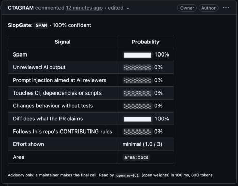
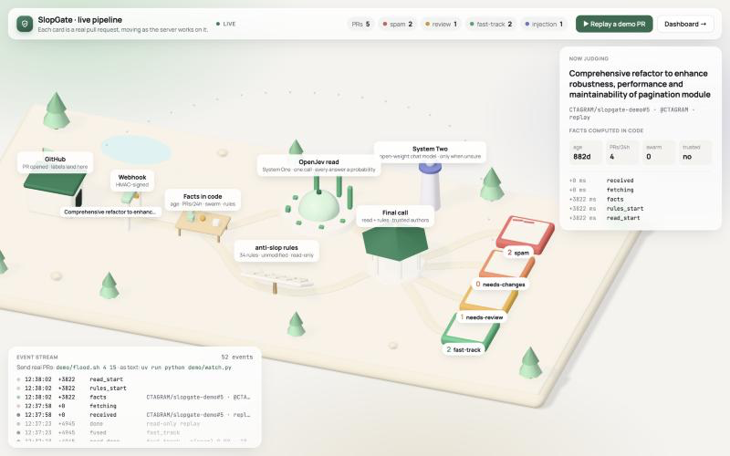
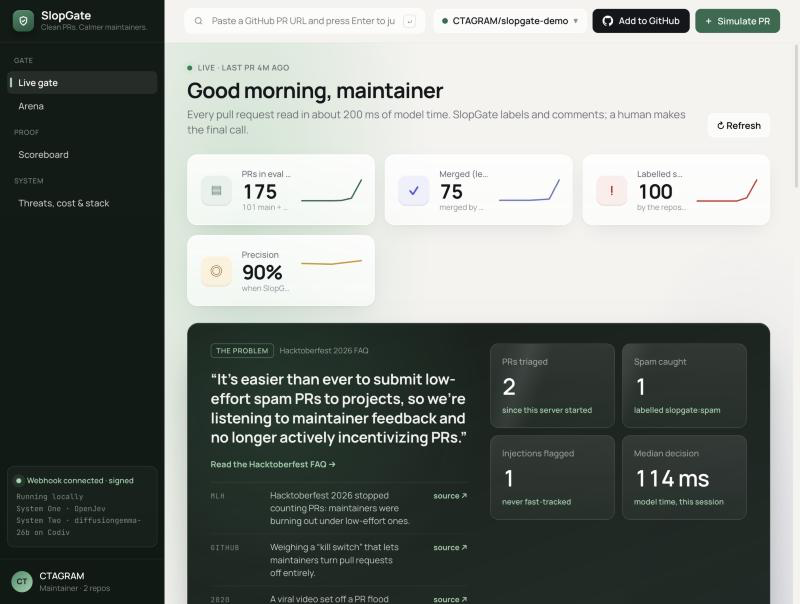
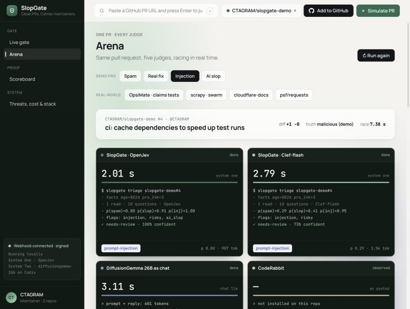
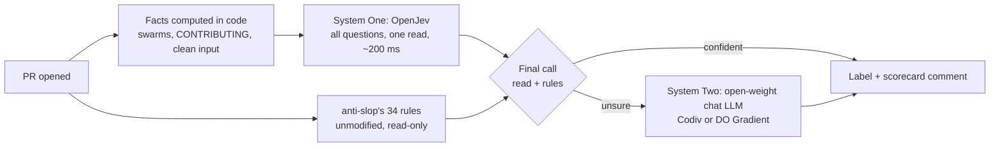

# SlopGate

**An open-weight gatekeeper that triages every pull request in about 100 ms**, so maintainers only
spend their attention on contributions that deserve it.

SlopGate reads a pull request (diff, description, linked issue, the repo's own `CONTRIBUTING`
rules, and contributor facts it computes itself) and asks an open-weight **System One** model a set
of typed questions in a single call. In parallel it runs the open-source [anti-slop](https://github.com/peakoss/anti-slop)'s 34 rule checks, unmodified, and fuses both into one final call. Every answer comes back as a calibrated probability, so the
gate knows the difference between *sure* and *guessing*. When it is unsure, it escalates to an
open-weight LLM. It never closes anything: it labels, explains, and leaves the call to a human.

**Live:** [slopgate.onrender.com](https://slopgate.onrender.com) (dashboard) ·
[3D pipeline](https://slopgate.onrender.com/sim) · open a PR on
[CTAGRAM/slopgate-demo](https://github.com/CTAGRAM/slopgate-demo) and watch it go through. (Free hosting
sleeps when idle; the first visit can take up to a minute.)

[](https://render.com/deploy?repo=https://github.com/CTAGRAM/slopgate)



## Why

- **Hacktoberfest 2026 stopped counting pull requests** because maintainers "began to burn out
  under the volume of low-effort, box-checking pull requests" and AI tools made it trivial to open
  a PR with no value ([MLH announcement](https://blog.mlh.com/mlh/hacktoberfest-2026-ai-belongs-to-everyone-3jl8),
  [Hacktoberfest FAQ](https://hacktoberfest.com/questions/)).
- **GitHub is weighing a pull request "kill switch"**, including letting maintainers turn PRs off
  entirely, because of low-quality AI contributions ([Feb 2026](https://www.opensourceforu.com/2026/02/github-weighs-pull-request-kill-switch-as-ai-slop-floods-open-source/)).
  curl ended its bug bounty, tldraw auto-closes outside PRs, Ghostty bans drive-by AI PRs.

Closing the door on everyone is the wrong fix. SlopGate keeps it open and puts a fast, honest
bouncer in front of it.

## What it checks

One request to the model answers all of these at once:

| Question | Type |
|---|---|
| Is this spam (self-promotion, trivial rewording, farming contributions)? | yes/no |
| Does it look like unreviewed AI output? | yes/no |
| Does it contain instructions aimed at AI reviewers (prompt injection), even in hidden HTML comments? | yes/no |
| Does it touch CI, dependencies, install scripts or credentials? | yes/no |
| Does the diff do what the title and description claim? What the linked issue asks? | yes/no |
| Does it follow this repo's `CONTRIBUTING` rules? | yes/no |
| How much genuine effort does it show? | score |
| Which area of the project is it (from the repo's own `area:*` labels)? | choice |
| Fast-track, needs review, needs changes, or spam? | choice |

When the verdict is spam, a second small read names the kind, like CodeRabbit's categories:
contributor-gaming, self-promotion, AI slop or low effort. (It is a separate read on purpose: OpenJev
reads a request's questions on one canvas, and an extra choice there shifted the other answers.)

Facts are computed in code, not guessed by the model:

- account age when the PR was opened, and how many PRs the author opened across GitHub in the 24 hours before
- **swarms**: near-identical PRs other people opened in this repo in the 48 hours before, and other
  people's PRs that already reference the same issue
- whether the description is the repo's PR template left unfilled, and whether the diff adds the author's own username
- diff size, whitespace-only and docs-only changes

And the input is cleaned first: summaries that review bots (such as CodeRabbit) edit into the
description, and HTML comments copied from the repo's own PR template, are removed, because the
contributor did not write them.

**anti-slop's 34 rules, fused in.** [anti-slop](https://github.com/peakoss/anti-slop) is the most popular
open-source slop filter: deterministic checks on account age, profile, fork bursts, merge ratio, branch,
blocked paths, description and more. SlopGate runs it unmodified, as a separate program, behind a
read-only proxy, at the same time as the model read. Its rules see what a model cannot (an author's
merge history across GitHub); the read sees what rules cannot (whether the diff does what it claims,
injection, swarms). The final call:

> **Spam** when an author without a track record in the repo fails **2 or more** rule checks, or when the
> read says spam. Otherwise the read's verdict stands. (`SLOPGATE_RULES_THRESHOLD` changes the 2.)
>
> The rules can only add spam, so when the read already says spam (or the author is trusted) the call is
> made at once, without waiting for them.

The scorecard lists every rule that failed and why.

**Trusted authors.** Like CodeRabbit's slop detection and anti-slop, SlopGate does not accuse the
repo's owners, members, collaborators or past contributors of spam. Their PRs still get every other
check, including prompt injection and risky files. Set `SLOPGATE_JUDGE_ALL_AUTHORS=1` to judge
everyone (CodeRabbit's `include_all_authors`).

## The dashboard

`slopgate serve` runs the webhook and a dashboard with four pages. Every number on them comes from the
live server or from [`eval/results`](eval/results); nothing is mocked.

- **Live gate**: every PR the webhook triages, as it arrives, with session stats. *Simulate PR* replays a
  real demo PR through the gate without labelling anything.
- **Arena**: one PR, every judge, racing live, including OpenJev's probability for every question and
  the rule that set the verdict. Paste any PR URL into the search box to judge it.
- **Scoreboard**: the evaluation, held-out and main sets, with confusion matrices, calibration and the
  P(spam) distribution.
- **Threats, cost & stack**: prompt injection, risky CI changes and swarms on real PRs, latency, the
  System One / System Two split, and the open models behind it.

- **Live pipeline** (`/sim`, an illustrated Three.js diorama): every real PR is a card that travels from
  GitHub, under the webhook arch, past the facts desk, through OpenJev's dome (pillars rise to each
  question's probability) and anti-slop's checklist board (tiles flip as rules pass or fail) in parallel,
  into the final-call gazebo and its verdict tray, driven by the server's event stream (`/api/events`)
  with the real timings.

Drive it from a terminal:

```bash
demo/flood.sh 4 15                 # open 4 real PRs on the demo repo, 15 s apart: spam, fix, injection, slop
uv run python demo/watch.py        # every stage of every PR, live, in your terminal
demo/cleanup.sh                    # close the PRs flood.sh opened
```







## How it works



The System One / System Two split is the harness: the fast model handles the clear cases, and the
slow, expensive model only runs when the fast one's own probabilities say it is unsure.

## Results on real pull requests

We test every judge on PRs that real maintainers labelled `spam`, against PRs merged in the same
repositories. Then we fixed what the misses taught us, and checked the fixes on PRs the system had
never seen.

### Main set: 101 PRs from 29 repositories, including Godot, scikit-learn and Scrapy

**Outside contributors: 34 real pull requests from 15 repositories**, 33 that maintainers labelled `spam` and 1 merged PRs from the same repositories.

| Contender | Kind | Judged | Spam caught (recall) | Precision | Spam fast-tracked | False alarms on merged PRs | Median time | Model time | Tokens / PR |
|---|---|---|---|---|---|---|---|---|---|
| SlopGate · final | Read + rules | 34/34 | 94% | 97% | 0% | 100% | 2.3 s | 238 ms | 1817 |
| SlopGate · OpenJev | System One | 34/34 | 52% | 100% | 3% | 0% | 1.8 s | 238 ms | 1817 |
| SlopGate · Clef-flash | System One | 34/34 | 30% | 100% | 18% | 0% | 1.2 s | 136 ms | 2302 |
| DiffusionGemma 26B as chat | Chat LLM | 34/34 | 36% | 100% | 27% | 0% | 1.2 s | 343 ms | 1571 |
| CodeRabbit | Observed | 1/34 | 100% | 100% | - | - | 6.7 min | - | - |
| anti-slop (34 rules) | Rules | 29/34 | 71% | 95% | 29% | 100% | 3.9 s | - | - |

**Everyone: 101 real pull requests from 29 repositories**, 60 that maintainers labelled `spam` and 41 merged PRs from the same repositories.

| Contender | Kind | Judged | Spam caught (recall) | Precision | Spam fast-tracked | False alarms on merged PRs | Median time | Model time | Tokens / PR |
|---|---|---|---|---|---|---|---|---|---|
| SlopGate · final | Read + rules | 101/101 | 52% | 97% | 2% | 2% | 1.2 s | 214 ms | 1937 |
| SlopGate · OpenJev | System One | 101/101 | 28% | 100% | 3% | 0% | 1.2 s | 214 ms | 1937 |
| SlopGate · Clef-flash | System One | 101/101 | 17% | 100% | 15% | 0% | 1.1 s | 127 ms | 2435 |
| DiffusionGemma 26B as chat | Chat LLM | 98/101 | 22% | 93% | 29% | 2% | 1.2 s | 342 ms | 1683 |
| CodeRabbit | Observed | 2/101 | 100% | 100% | - | 0% | 3.7 min | - | - |
| anti-slop (34 rules) | Rules | 96/101 | 38% | 84% | 62% | 10% | 164 ms | - | - |

How SlopGate got here, on the same 101 PRs:

| Version | What changed | Spam caught | Precision | False alarms on merged PRs |
|---|---|---|---|---|
| v1 | Rules written before we saw any data | 22% | 87% | 5% |
| v2 | + swarm detection | 25% | 83% | 7% |
| v3 | + CodeRabbit's trusted-author rule, bot text and template comments stripped, unfilled-template fact | 28% | 100% | 0% |
| v4 (final) | + anti-slop's 34 rules, fused with the read | **52%** | **97%** | **2%** |

- **Every v2 false alarm was a PR by the repo's owner or a collaborator.** CodeRabbit and anti-slop
  never judge those authors for spam, and adopting the same rule removed all of them.
- **Much of today's spam does not look like spam.** scrapy received
  [#8307](https://github.com/scrapy/scrapy/pull/8307), [#8308](https://github.com/scrapy/scrapy/pull/8308)
  and [#8309](https://github.com/scrapy/scrapy/pull/8309) within hours: three accounts "fixing" the
  same bug, each with tests, all labelled spam. No judge that looks at one PR at a time can see that,
  which is why SlopGate now detects swarms.
- **Review bots write into PR descriptions.** In 34 of the 74 held-out PRs, CodeRabbit had edited its
  own summary into the description. Left in, a judge reads a bot's words as the contributor's.
- **A chat model ranks about as well when given the same facts** (ROC AUC of its stated spam
  probability: 0.82, versus 0.80 for OpenJev's), but returns one self-reported number and sometimes
  no parseable answer. SlopGate returns nine calibrated signals in one read that cannot go off-schema.
- The 24 "spam" PRs opened by repo owners are almost all forks of OWASP Juice Shop, where upstream's
  labelling automation marks the owner's own PRs. That is why the outside-contributor view is the headline.

### Held out: 74 PRs CodeRabbit reviewed, never used to build SlopGate

**Outside contributors: 25 real pull requests from 14 repositories**, 23 that maintainers labelled `spam` and 2 merged PRs from the same repositories.

| Contender | Kind | Judged | Spam caught (recall) | Precision | Spam fast-tracked | False alarms on merged PRs | Median time | Model time | Tokens / PR |
|---|---|---|---|---|---|---|---|---|---|
| SlopGate · final | Read + rules | 25/25 | 100% | 92% | 0% | 100% | 3.3 s | 259 ms | 1617 |
| SlopGate · OpenJev | System One | 25/25 | 39% | 90% | 0% | 50% | 1.2 s | 259 ms | 1617 |
| SlopGate · Clef-flash | System One | 25/25 | 17% | 80% | 17% | 50% | 897 ms | 107 ms | 2178 |
| DiffusionGemma 26B as chat | Chat LLM | 24/25 | 18% | 100% | 5% | 0% | 1.1 s | 366 ms | 1370 |
| CodeRabbit | Observed | 17/25 | 7% | 100% | - | 0% | 2.1 min | - | - |
| anti-slop (34 rules) | Rules | 25/25 | 74% | 94% | 26% | 50% | 4.2 s | - | - |

**Everyone: 74 real pull requests from 23 repositories**, 40 that maintainers labelled `spam` and 34 merged PRs from the same repositories.

| Contender | Kind | Judged | Spam caught (recall) | Precision | Spam fast-tracked | False alarms on merged PRs | Median time | Model time | Tokens / PR |
|---|---|---|---|---|---|---|---|---|---|
| SlopGate · final | Read + rules | 74/74 | 57% | 92% | 2% | 6% | 1.2 s | 314 ms | 1979 |
| SlopGate · OpenJev | System One | 74/74 | 22% | 90% | 2% | 3% | 1.1 s | 314 ms | 1979 |
| SlopGate · Clef-flash | System One | 74/74 | 10% | 80% | 30% | 3% | 899 ms | 134 ms | 2496 |
| DiffusionGemma 26B as chat | Chat LLM | 73/74 | 26% | 100% | 23% | 0% | 1.2 s | 387 ms | 1740 |
| CodeRabbit | Observed | 58/74 | 3% | 100% | - | 0% | 75.5 s | - | - |
| anti-slop (34 rules) | Rules | 74/74 | 48% | 63% | 52% | 32% | 3.7 s | - | - |

**On PRs it had never seen, SlopGate's final call beat every other judge where it matters for a gate.**
It caught **57%** of the spam, against 48% for anti-slop alone and 3% for CodeRabbit; it was right
**92%** of the time it said spam (anti-slop: 63%); it raised **2** false alarms on 34 merged PRs
(anti-slop would have closed **11**); and it waved only **1 of 40** spam PRs through to fast-track
(anti-slop: 21). A chat model given the same facts was more precise when it spoke (100%) but caught
less than half as much (26%) and fast-tracked 23% of the spam.

How the fusion rule was chosen, so the held-out numbers stay honest: four candidate rules were written
down first and compared on the main set only. "Untrusted author and enough failed rules, or the read
says spam" won there, and 2 failed rules gave the best recall at the same false-alarm count, so 2 is the
default. The held-out set confirmed it. (With 3, held out: 55% caught, 96% precision, 1 false alarm.)

Speed: the rules can only add a spam verdict and never apply to trusted authors, so the final call waits
for anti-slop (about 50 GitHub API calls per PR) only when the read hasn't already settled it. The median
final call takes about 1.2 seconds, against CodeRabbit's minute or more.

### How the test works

Code is in [`eval/`](eval).

- **Spam PRs** are real PRs that their maintainers labelled `spam` since January 2025.
  **Merged PRs** come from the *same repositories*, so a judge cannot score well just by telling
  documentation repos from code repos.
- Bots and deleted accounts are excluded (a deleted account would leak the answer).
- **CodeRabbit** is a closed service with no API, so we read what it actually posted on each PR,
  including its "flagged as potential spam" warning.
- **anti-slop** (the most popular open-source slop filter, 34 rules) runs unmodified behind a
  read-only proxy: it can read GitHub, but every write it attempts (label, comment, close) is blocked.
  Runs that hit GitHub rate limits are excluded rather than scored.
- Times are measured from a laptop in India, so they include the round trip to the US. "Model time"
  is the model's own time, as reported by the server.
- The exact PR lists are in [`eval/results/`](eval/results) (`*.urls.tsv`); rebuild a set with
  `uv run python eval/collect.py --urls eval/results/prs.urls.tsv`.

## Use it

**As a GitHub Action** (no server). Add `.github/workflows/slopgate.yml`:

```yaml
on:
  pull_request_target:
    types: [opened, reopened, edited, synchronize]
permissions:
  pull-requests: write
  issues: write
jobs:
  slopgate:
    runs-on: ubuntu-latest
    steps:
      - uses: CTAGRAM/slopgate@main
        with:
          codiv-api-key: ${{ secrets.CODIV_API_KEY }}
```

The action reads the PR through the API only. It never checks out or runs the contributor's code.

**From your coding agent**: [`skills/slopgate`](skills/slopgate) is an
[Agent Skill](https://agentskills.io) (validated with `skills-ref`). Ask your agent to "triage the
open PRs in this repo".

**From the command line**:

```bash
uv run slopgate triage https://github.com/OWNER/REPO/pull/123           # print the scorecard
uv run slopgate triage https://github.com/OWNER/REPO/pull/123 --apply   # label + comment
uv run slopgate compare https://github.com/OWNER/REPO/pull/123          # every judge, side by side
```

**As a webhook server with the dashboard**, on your machine, on Render ([`render.yaml`](render.yaml), the
live demo), on DigitalOcean App Platform ([`.do/app.yaml`](.do/app.yaml)) or a Droplet over SSH
([`deploy/deploy.sh`](deploy/deploy.sh)):

```bash
uv run slopgate serve      # http://localhost:8000: arena, live gate feed, scoreboard
```

Configuration lives in environment variables (or `.env.local`): `CODIV_API_KEY`, `GITHUB_TOKEN`,
`GITHUB_WEBHOOK_SECRET`, and optionally `OPENJEV_BASE_URL`, `SLOPGATE_MODEL`, `GRADIENT_API_KEY`,
`GRADIENT_MODEL`.

## Models and licences

| Role | Model | Weights licence |
|---|---|---|
| System One (default) | [OpenJev 0.1](https://github.com/razorback16/openjev): DiffusionGemma 26B-A4B (NVIDIA / Google) read as a decision model | Apache-2.0 |
| System One (fast option) | [Clef-flash 1.0](https://huggingface.co/Cloudflare/clef-flash) (Cloudflare), Qwen3.5-9B base | Apache-2.0 |
| System Two | open-weight chat model on [DigitalOcean Gradient](https://docs.digitalocean.com/products/inference-hub/), e.g. gpt-oss | Apache-2.0 |
| Arena baseline | DiffusionGemma 26B as a chat model | Apache-2.0 |

Both System One models are served free on [Codiv](https://codiv.ai) through a Jev-compatible API.
Everything is open: point `OPENJEV_BASE_URL` at your own GPU running the
[OpenJev server](https://github.com/razorback16/openjev) (Apache-2.0) and no PR ever leaves your
infrastructure.

[anti-slop](https://github.com/peakoss/anti-slop) is AGPL-3.0. SlopGate does not copy or link its code: it
runs the unmodified action as a separate program (`node dist/index.mjs`, cloned at install time) and
reads its outputs, so SlopGate itself stays MIT. Thank you to its authors. CodeRabbit appears only in
the evaluation, through its public PR comments.

## Safety

- Advisory only: SlopGate labels and comments. It never closes, merges or locks a PR.
- Everything inside a PR is treated as untrusted data, marked as such in the model's input, and
  checked for instructions aimed at AI reviewers. A PR flagged for prompt injection can never be
  fast-tracked.
- Webhooks are verified with `GITHUB_WEBHOOK_SECRET`.

## Licence

MIT. See [LICENSE](LICENSE).
