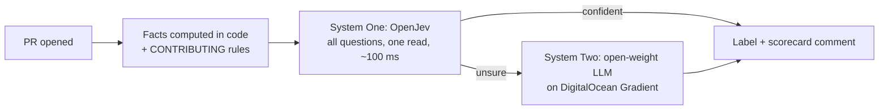

# SlopGate

**An open-weight gatekeeper that triages every pull request in about 100 ms**, so maintainers only
spend their attention on contributions that deserve it.

SlopGate reads a pull request (diff, description, linked issue, the repo's own `CONTRIBUTING`
rules, and contributor facts it computes itself) and asks an open-weight **System One** model a set
of typed questions in a single call. Every answer comes back as a calibrated probability, so the
gate knows the difference between *sure* and *guessing*. When it is unsure, it escalates to an
open-weight LLM. It never closes anything: it labels, explains, and leaves the call to a human.


## Why

- **Hacktoberfest 2026 stopped counting pull requests** because maintainers "began to burn out
  under the volume of low-effort, box-checking pull requests" and AI tools made it trivial to open
  a PR with no value ([MLH announcement](https://blog.mlh.com/mlh/hacktoberfest-2026-ai-belongs-to-everyone-3jl8),
  [Hacktoberfest FAQ](https://hacktoberfest.com/questions/)).
- **GitHub is weighing a pull request "kill switch"**, including letting maintainers turn PRs off
  entirely, because of low-quality AI contributions ([Feb 2026](https://www.opensourceforu.com/2026/02/github-weighs-pull-request-kill-switch-as-ai-slop-floods-open-source/)).
  curl ended its bug bounty, tldraw auto-closes outside PRs, Ghostty bans drive-by AI PRs.

Closing the door on everyone is the wrong fix. SlopGate keeps it open and puts a fast, honest
bouncer in front of it.

## What it checks

One request to the model answers all of these at once:

| Question | Type |
|---|---|
| Is this spam (self-promotion, trivial rewording, farming contributions)? | yes/no |
| Does it look like unreviewed AI output? | yes/no |
| Does it contain instructions aimed at AI reviewers (prompt injection), even in hidden HTML comments? | yes/no |
| Does it touch CI, dependencies, install scripts or credentials? | yes/no |
| Does the diff do what the title and description claim? What the linked issue asks? | yes/no |
| Does it follow this repo's `CONTRIBUTING` rules? | yes/no |
| How much genuine effort does it show? | score |
| Which area of the project is it (from the repo's own `area:*` labels)? | choice |
| Fast-track, needs review, needs changes, or spam? | choice |

Counting is done in code, not by the model: account age when the PR was opened, how many PRs the
author opened across GitHub in the previous 24 hours, diff size, whitespace-only and docs-only
changes, and whether the diff adds the author's own username.

## How it works



The System One / System Two split is the harness: the fast model handles the clear cases, and the
slow, expensive model only runs when the fast one's own probabilities say it is unsure.

## Results on real pull requests

RESULTS_TABLE

How the test works (code in [`eval/`](eval)):

- **Spam PRs** are real PRs that their maintainers labelled `spam` since January 2025.
  **Merged PRs** come from the *same repositories*, so a judge cannot score well just by telling
  documentation repos from code repos.
- Bots and deleted accounts are excluded (a deleted account would leak the answer).
- SlopGate's questions and verdict rules were written **before** this dataset was collected.
- **CodeRabbit** is a closed service with no API, so we read what it actually posted on each PR.
  It only has an opinion where a repo installed it.
- **anti-slop** (the most popular open-source slop filter, 34 rules) runs unmodified behind a
  read-only proxy: it can read GitHub but every write it attempts (label, comment, close) is blocked.
- The exact PR list is in [`eval/results/prs.urls.tsv`](eval/results/prs.urls.tsv); rebuild it with
  `uv run python eval/collect.py --urls eval/results/prs.urls.tsv`.

## Use it

**As a GitHub Action** (no server). Add `.github/workflows/slopgate.yml`:

```yaml
on:
  pull_request_target:
    types: [opened, reopened, edited, synchronize]
permissions:
  pull-requests: write
  issues: write
jobs:
  slopgate:
    runs-on: ubuntu-latest
    steps:
      - uses: CTAGRAM/slopgate@main
        with:
          codiv-api-key: ${{ secrets.CODIV_API_KEY }}
```

The action reads the PR through the API only. It never checks out or runs the contributor's code.

**From your coding agent**: [`skills/slopgate`](skills/slopgate) is an
[Agent Skill](https://agentskills.io) (validated with `skills-ref`). Ask your agent to "triage the
open PRs in this repo".

**From the command line**:

```bash
uv run slopgate triage https://github.com/OWNER/REPO/pull/123           # print the scorecard
uv run slopgate triage https://github.com/OWNER/REPO/pull/123 --apply   # label + comment
uv run slopgate compare https://github.com/OWNER/REPO/pull/123          # every judge, side by side
```

**As a webhook server with the arena page**, on your machine or on DigitalOcean App Platform
([`.do/app.yaml`](.do/app.yaml)):

```bash
uv run slopgate serve      # http://localhost:8000: arena, live gate feed, scoreboard
```

Configuration lives in environment variables (or `.env.local`): `CODIV_API_KEY`, `GITHUB_TOKEN`,
`GITHUB_WEBHOOK_SECRET`, and optionally `OPENJEV_BASE_URL`, `SLOPGATE_MODEL`, `GRADIENT_API_KEY`,
`GRADIENT_MODEL`.

## Models and licences

| Role | Model | Weights licence |
|---|---|---|
| System One (default) | [OpenJev 0.1](https://github.com/razorback16/openjev): DiffusionGemma 26B-A4B (NVIDIA / Google) read as a decision model | Apache-2.0 |
| System One (fast option) | [Clef-flash 1.0](https://huggingface.co/Cloudflare/clef-flash) (Cloudflare), Qwen3.5-9B base | Apache-2.0 |
| System Two | open-weight chat model on [DigitalOcean Gradient](https://docs.digitalocean.com/products/inference-hub/), e.g. gpt-oss | Apache-2.0 |
| Arena baseline | DiffusionGemma 26B as a chat model | Apache-2.0 |

Both System One models are served free on [Codiv](https://codiv.ai) through a Jev-compatible API.
Everything is open: point `OPENJEV_BASE_URL` at your own GPU running the
[OpenJev server](https://github.com/razorback16/openjev) (Apache-2.0) and no PR ever leaves your
infrastructure.

Contenders we compare against, not part of SlopGate: [anti-slop](https://github.com/peakoss/anti-slop)
(AGPL-3.0, run unmodified as a separate process, not distributed) and CodeRabbit (its public PR
comments only).

## Safety

- Advisory only: SlopGate labels and comments. It never closes, merges or locks a PR.
- Everything inside a PR is treated as untrusted data, marked as such in the model's input, and
  checked for instructions aimed at AI reviewers. A PR flagged for prompt injection can never be
  fast-tracked.
- Webhooks are verified with `GITHUB_WEBHOOK_SECRET`.

## Licence

MIT. See [LICENSE](LICENSE).
